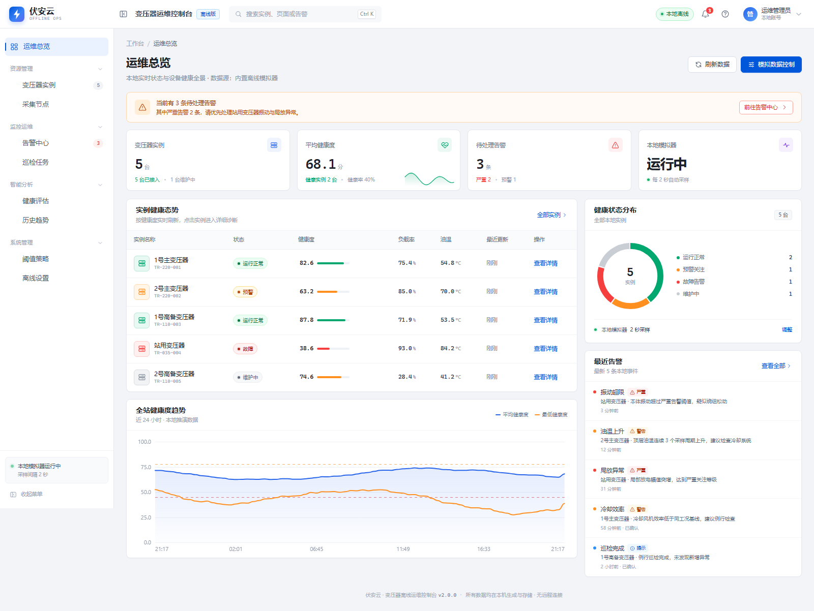
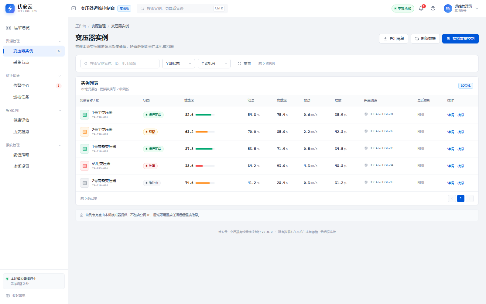
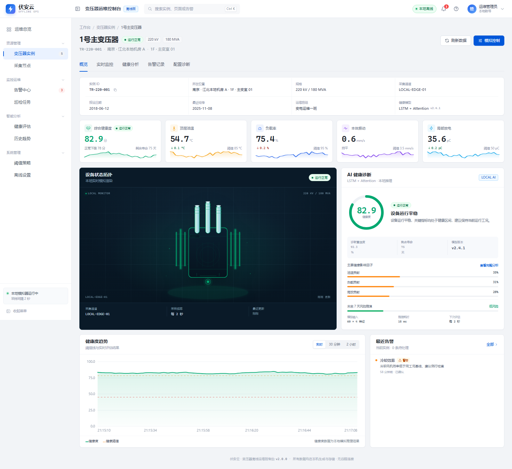
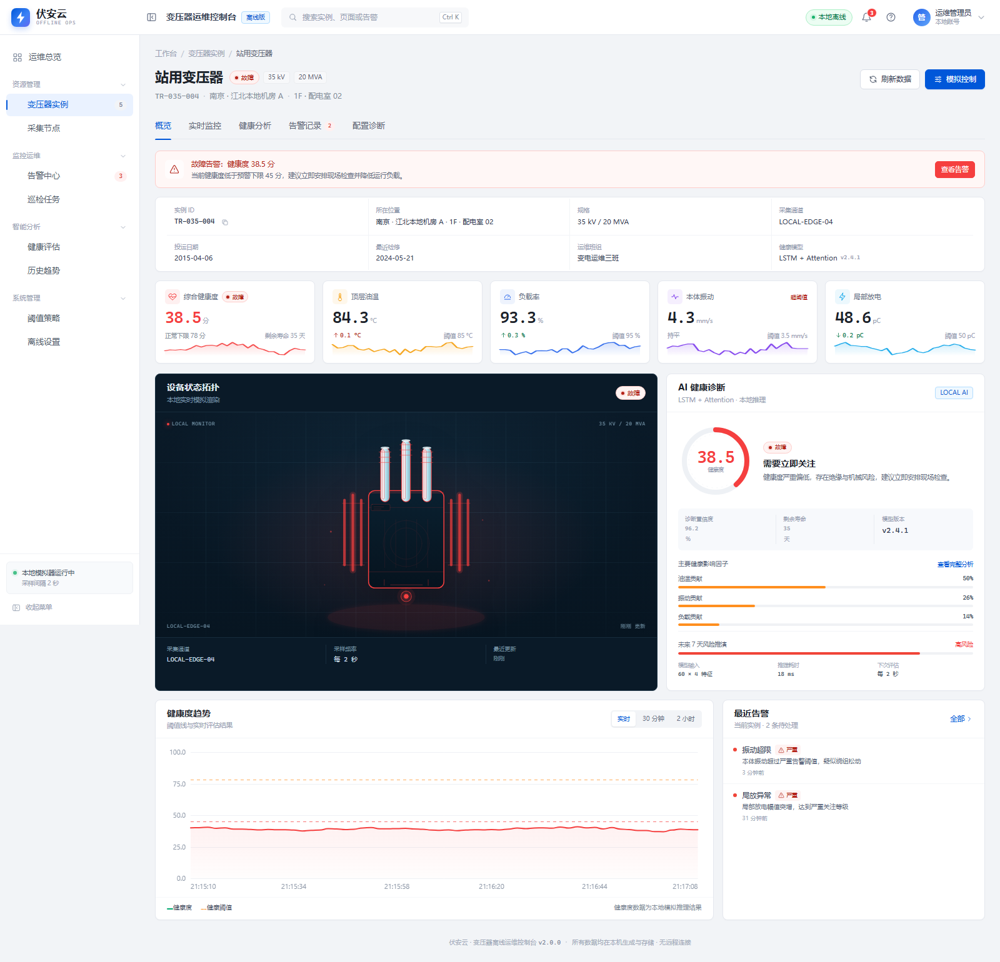
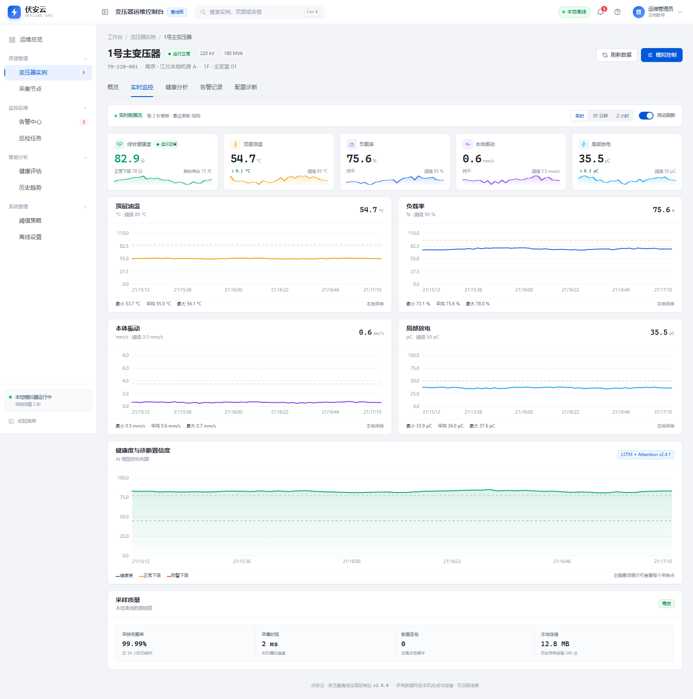
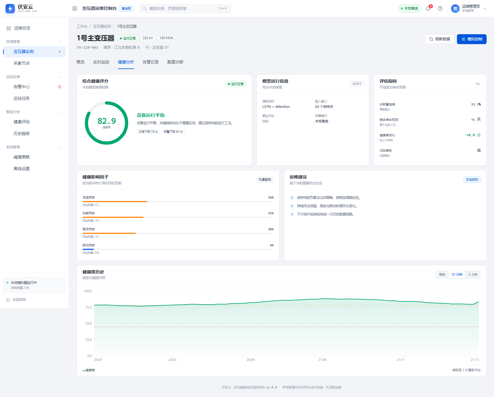
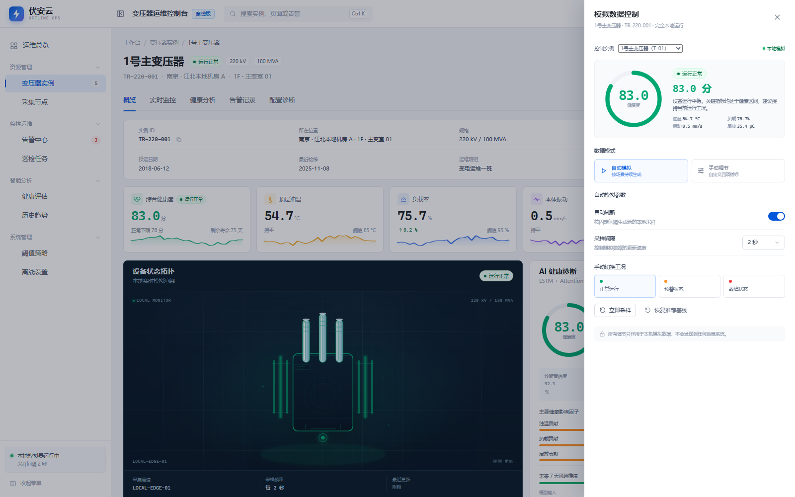

# 变压器离线运维控制台

一个面向本地变压器设备的**完全离线桌面运维控制台**，采用类似云服务器实例管理页面的多级控制台结构：资源总览、实例列表、实例详情、监控、健康分析、告警、阈值策略和离线设置。

**当前版本不接入真实传感器，所有数据由本机模拟器自动或手动生成，不建立任何远程连接。**



## 安装与运行

### 直接安装（推荐）

安装包位于：

```text
dist\Transformer-Offline-Console-Setup-2.0.0.exe
```

双击安装包即可。安装器为交互式向导，单用户安装，不需要管理员权限。

安装向导首屏就是新增的 **「本机检测与安装位置」** 页面：

- 自动读取本机已安装版本、安装路径，并在页面中直接显示；
- 检测到旧版本时明确提示“继续安装将覆盖程序文件，但保留本机配置与模拟数据”；
- 提供安装目录输入框和「浏览...」按钮，可重新选择安装位置；
- 如果修改了安装路径，安装器会再次提示：先移除旧版本，再安装到新目录，避免重复安装；
- 安装目录会提前做创建和写入权限校验；
- 完成页默认勾选运行应用，点击完成后启动；同时创建桌面和开始菜单快捷方式。

- 发布版本：2.0.0
- 平台：Windows x64
- 安装后运行：`变压器离线运维控制台`
- 卸载：Windows 设置 → 应用 → 已安装的应用 → 变压器离线运维控制台
- 应用数据目录：`%APPDATA%\TransformerOfflineConsole`

已在本机完成检测页、路径变更提示、静默安装与启动验证：安装目录为 `%LOCALAPPDATA%\Programs\transformer-offline-console`，桌面和开始菜单快捷方式均正常，启动后可完全断网运行。

> 安装包未做商业代码签名。部分电脑首次运行可能出现 Windows SmartScreen 提示，此时选择“更多信息 → 仍要运行”即可。该提示不代表应用需要联网。

### 免安装便携版

```text
dist\Transformer-Offline-Console-Portable-2.0.0.exe
```

便携版无需安装，双击后在本机解压并启动；适合无法安装软件的受控环境。

### 从源码运行

环境要求：Node.js 18+，Windows 10/11 x64。

```bash
npm install
npm start
```

如果是从当前已构建目录直接运行，依赖已包含在 `node_modules` 中，可以直接执行 `npm start`，或双击 `run-source.bat`。

## 多级控制台结构

```text
顶栏（全局搜索 / 通知 / 离线状态 / 本地管理员）
└─ 左侧导航
   ├─ 运维总览
   ├─ 资源管理
   │  ├─ 变压器实例
   │  └─ 采集节点
   ├─ 监控运维
   │  ├─ 告警中心
   │  └─ 巡检任务
   ├─ 智能分析
   │  ├─ 健康评估
   │  └─ 历史趋势
   └─ 系统管理
      ├─ 阈值策略
      └─ 离线设置

变压器实例详情
└─ 页签：概览 / 实时监控 / 健康分析 / 告警记录 / 配置诊断
```

## 核心功能

### 1. 实例资源管理

- 5 台本地模拟变压器：主变、高备变、站用变，包含运行、预警、故障、维护四种状态。
- 实例列表支持按名称 / ID / 电压等级搜索，按状态和机房筛选。
- 每个实例含资产信息、电压等级、容量、冷却方式、采集通道、运行班组、模型版本和服务年限修正。



### 2. 实例详情概览

- 五张实时指标卡：综合健康度、顶层油温、负载率、本体振动、局部放电。
- 设备状态拓扑：本地实时渲染的变压器模型，随健康状态切换绿色 / 黄色 / 红色，并带扫描线与运行 HUD。
- AI 健康诊断：健康评分环、诊断结论、诊断置信度、剩余寿命、主要影响因子和未来 7 天风险推演。
- 健康度趋势、最近告警和基础档案。
- 顶部页签进入实时监控、健康分析、告警记录和阈值配置。



故障实例：



### 3. 实时监控

- 实时 / 30 分钟 / 2 小时范围切换。
- 油温、负载率、振动、局部放电四张独立趋势图，带阈值虚线、悬停数据提示、最小值 / 平均值 / 最大值。
- 健康度与诊断置信度综合曲线。
- 采样质量：完整率、时延、丢包和本地存储。



### 4. 健康分析

- 综合健康评分与模型运行信息。
- 诊断置信度、剩余寿命、健康度变化和风险等级。
- 健康影响因子权重解释与运维建议。
- 历史健康曲线与阈值对照。



### 5. 告警中心

- 全局告警与单实例告警两级视图。
- 按级别、状态、实例和关键词筛选。
- 支持单条确认与全部确认，确认状态保存在本机。
- 告警在阈值首次越界或健康状态恶化时自动生成，5 分钟内相同类别自动去重。

### 6. 巡检任务

- 4 项本地巡检任务，支持一键运行。
- 执行结果根据当前模拟实例状态自动生成。
- 所有巡检仅在本机内存与浏览器存储中完成，不执行远程命令。

### 7. 阈值策略

- 全局默认阈值与实例级覆盖。
- 六项阈值：健康度正常下限、健康度预警下限、油温告警、振动告警、局放告警和负载告警。
- 校验正常下限必须大于预警下限，保存后立即重新判定状态。
- 阈值持久化在本机。

### 8. 离线设置

- 展示外部网络请求拦截、无云账号登录、无远程更新、本地数据存储等状态。
- 自动刷新开关、采样间隔（1 / 2 / 5 秒）、立即采样、手动调节。
- 本地快照导出、演示数据重置。
- 应用版本与运行环境信息。

## 自动 / 手动模拟数据

### 自动模拟

每个实例由本机模拟器按固定间隔自动更新指标：

- 默认每 **2 秒** 采样一次；
- 可根据预设工况（正常 / 预警 / 故障）缓慢逼近目标值并叠加平滑波动；
- 自动刷新可在离线设置、实时监控页或模拟控制抽屉中暂停 / 恢复；
- 状态、颜色、告警和图表随数据同步刷新。

### 手动调节

点击任意页面右上角的「模拟数据控制」，选择「手动调节」：

- 拖动滑杆直接调整顶层油温、负载率、本体振动和局部放电；
- 健康度、风险等级和状态会即时重新计算；
- 可在同一抽屉中切换实例，互不影响；
- 可随时恢复推荐基线或切回自动模拟。



### 健康度计算与状态判定

本版本的模拟健康度由四项监测量和实例老化修正共同计算：

```text
健康度 = 100
       - max(0, 油温 - 50) × 0.90
       - max(0, 负载率 - 60) × 0.25
       - max(0, 振动 - 0.40) × 4.00
       - max(0, 局放 - 20) × 0.22
       - 设备老化修正
```

状态判定：

| 条件 | 状态 |
| --- | --- |
| 健康度 ≥ 正常下限 | 运行正常 |
| 预警下限 ≤ 健康度 < 正常下限 | 预警 |
| 健康度 < 预警下限 | 故障 |
| 任一传感器达到告警阈值 | 至少提升为预警 |
| 生命周期为检修 | 维护中 |

剩余寿命按 `健康度 × 0.9` 估算；诊断置信度随健康度变化。以上均属于本地演示算法，不代表真实诊断结论。

## 完全离线保障

桌面版从架构上禁止远程连接：

- Electron 主进程启动时关闭后台联网、组件更新、崩溃上报、同步与预取；
- 使用 `host-resolver-rules` 禁止全部域名解析；
- 通过 `webRequest` 拦截所有 `http / https / ws / wss` 请求；
- 拒绝权限申请、新窗口、外部导航和 WebView；
- 渲染进程 CSP 设置 `connect-src 'none'`；
- 所有 HTML、CSS、JS、SVG、图标全部打包在安装包内；
- 没有 CDN、远程字体、自动更新、账号系统或云端接口。

详见 [离线架构与打包说明](docs/offline-architecture.md)。

## 快捷键

| 快捷键 | 功能 |
| --- | --- |
| `Ctrl + K` | 打开全局搜索 |
| `↑` / `↓` | 在搜索结果中移动 |
| `Enter` | 打开选中结果 |
| `Esc` | 关闭搜索、通知、弹窗或模拟控制抽屉 |

## 构建安装包

当前源码内置了 Electron 与 electron-builder 的本地依赖。

推荐直接双击：

```text
build-installer.bat
```

脚本内容为 **纯 ASCII + CRLF**，可避免 Windows 旧版 cmd.exe 的中文编码乱码问题；脚本会自动清除 `ELECTRON_RUN_AS_NODE` 环境变量并调用 `npm run build:win`。

也可以手动构建：

```bash
npm run build:win
```

构建产物：

```text
dist/
├─ Transformer-Offline-Console-Setup-2.0.0.exe
├─ Transformer-Offline-Console-Portable-2.0.0.exe
├─ SHA256SUMS.txt
└─ win-unpacked/
```

SHA-256：

```text
4337F8378DC674DA56DCE3067AA4534B296479392482071F2A45C789A6392DE2  Transformer-Offline-Console-Setup-2.0.0.exe
954509F910911F4D936281D1965FFE1D0376488C04A62EB33AB7F53811C22E8F  Transformer-Offline-Console-Portable-2.0.0.exe
```

## 项目结构

```text
transformer-offline-console/
├─ electron/
│  └─ main.js                  Electron 主进程与离线安全边界
├─ renderer/
│  ├─ index.html               控制台外壳与图标库
│  ├─ assets/                  应用图标
│  ├─ css/app.css              控制台主题与响应式布局
│  └─ js/
│     ├─ util.js               通用工具、指标定义与主题
│     ├─ data.js               实例数据、模拟引擎、告警与巡检
│     ├─ charts.js             原生 Canvas 折线图与悬停提示
│     ├─ components.js         通用 UI 组件
│     ├─ pages-common.js       页面公共部件与设备 SVG
│     ├─ pages-main.js         总览、实例列表、告警、节点、巡检
│     ├─ pages-instance.js     实例详情五个页签
│     ├─ pages-analysis.js     健康评估、历史、策略、设置
│     └─ app.js                路由、抽屉、通知、搜索与交互
├─ docs/
│  ├─ offline-architecture.md  离线隔离与安装打包说明
│  └─ simulation-guide.md      模拟数据、算法与状态规则
├─ screenshots/                运行截图
├─ build/
│  ├─ icon.ico                 安装器与应用图标
│  └─ installer.nsh            本机检测、安装地址与写权限校验页面
├─ dist/                       安装包与便携版
├─ build-installer.bat         纯 ASCII CRLF 构建脚本
├─ run-source.bat              纯 ASCII CRLF 源码启动脚本
├─ package.json
└─ README.md
```

## 数据存储

- 阈值策略、自动刷新设置、侧边菜单折叠状态、告警已读 / 确认状态存储在 `localStorage`；
- 模拟指标、历史采样和通知在当前运行会话内存在内存中；
- 重置演示数据会清空本机阈值与告警状态并重新生成初始实例。

## 版本

**v2.0.0 — 离线控制台重构**

- 从单页深色监测看板升级为浅色多级运维控制台；
- 增加实例列表、详情页签、告警中心、健康评估、历史趋势、巡检任务和离线设置；
- 增加自动模拟与手动滑杆调节；
- 增加 Electron 桌面壳、离线网络隔离和 Windows 安装包。
